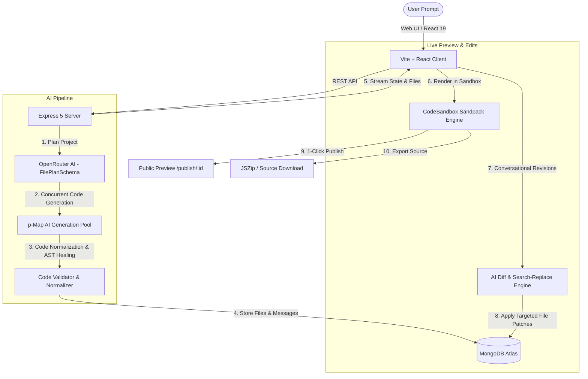

# 🚀 BuilderAI — Autonomous AI Web Application Builder

<div align="center">


**Turn natural language prompts into live, interactive, full-featured React web applications with real-time in-browser sandboxing and conversational AI revisions.**

[Features](#-key-features) • [Architecture](#-architecture) • [Getting Started](#-getting-started) • [Environment Variables](#-environment-variables) • [API Reference](#-api-endpoints) • [Codebase Guide](./CODEBASE_GUIDE.md)

</div>

---

## 🌟 Overview

**BuilderAI** is an end-to-end autonomous web builder platform (inspired by v0, Lovable, and Bolt.new). It takes a single user prompt and orchestrates a multi-phase AI generation pipeline:
1. **Architects the application structure** (components, styles, routes, and utilities).
2. **Generates clean, production-ready React code** concurrently across multiple files.
3. **Validates & auto-heals code** (strips fences, converts JSX attributes, self-closes tags, normalizes escape sequences).
4. **Executes live inside an in-browser Sandpack sandbox** with zero local compilation required.
5. **Enables interactive conversational chat revisions** using a precise search-and-replace AST diff engine.
6. **1-Click Publishing & Source Code Export** (download full project as a `.zip`).

---

## 🏗️ Architecture



---

## ✨ Key Features

- **⚡ Autonomous Prompt-to-App:** Transform ideas into responsive, beautifully styled web applications with zero boilerplates.
- **🖥️ In-Browser Live Preview:** Embedded `@codesandbox/sandpack-react` environment renders React 19 and Tailwind CSS apps in real time.
- **💬 Conversational AI Iteration:** Chat with your app to revise layouts, tweak themes, add features, or refine components on the fly.
- **🩹 Self-Healing Code Pipeline:** Intelligent regex/AST validators fix common LLM mistakes (unclosed tags, missing default exports, invalid JSX attributes like `class=` or `for=`, double-escaped strings) before files touch the database.
- **🧩 Targeted Search-and-Replace Diffs:** Revisions apply targeted surgical diffs instead of rewriting whole files, saving tokens and preserving manual edits.
- **🌐 1-Click Public Deployment:** Publish any generated project with a shareable public URL (`/publish/:id`).
- **📦 ZIP Source Code Export:** Download complete project codebases directly to your machine.
- **🔐 Secure Authentication:** Built-in JWT authentication with HTTP-only cookies, password hashing (bcrypt), and authenticated project ownership.

---

## 🛠️ Tech Stack

### Frontend
- **Framework:** [React 19](https://react.dev/) + [Vite](https://vitejs.dev/)
- **Styling:** [Tailwind CSS v4](https://tailwindcss.com/)
- **Sandbox Engine:** [@codesandbox/sandpack-react](https://sandpack.codesandbox.io/)
- **Routing & State:** [React Router v7](https://reactrouter.com/), Context API
- **Icons & UI:** [Lucide React](https://lucide.dev/), [React Hot Toast](https://react-hot-toast.com/)
- **Export Utility:** [JSZip](https://stuk.github.io/jszip/), [FileSaver](https://github.com/eligrey/FileSaver.js/)

### Backend
- **Runtime:** [Node.js](https://nodejs.org/) (ES Modules)
- **Framework:** [Express 5](https://expressjs.com/)
- **Database & ODM:** [MongoDB Atlas](https://www.mongodb.com/atlas) with [Mongoose 9](https://mongoosejs.com/)
- **AI Integration:** [Vercel AI SDK](https://sdk.vercel.ai/) (`ai`) + [@ai-sdk/openai](https://www.npmjs.com/package/@ai-sdk/openai)
- **AI Gateway:** [OpenRouter](https://openrouter.ai/) (supports models like Cohere North Mini, Claude, GPT-4o, etc.)
- **Concurrency & Validation:** [p-map](https://github.com/sindresorhus/p-map), [Zod 4](https://zod.dev/)
- **Security:** JSON Web Tokens (`jsonwebtoken`), `cookie-parser`, `bcrypt`, `cors`

---

## 📂 Project Structure

```
Builder_AI/
├── client/                     # Vite + React Frontend
│   ├── src/
│   │   ├── api/                # Axios instance & API client
│   │   ├── components/         # Sandpack preview, chat panel, file explorer, header
│   │   ├── context/            # Global AppContext (projects, auth, state)
│   │   ├── pages/              # Homepage, BuilderPage, AuthPage, PublishPage, PreviewPage
│   │   └── App.jsx             # Main Router layout
│   ├── .env.example            # Client environment template
│   └── package.json
│
├── server/                     # Node.js + Express Backend
│   ├── config/                 # MongoDB database connection
│   ├── controllers/
│   │   ├── authController.js   # User registration, login, logout, me
│   │   ├── chatController.js   # Conversational project revision controller
│   │   └── projectController.js# Create, list, fetch, update, delete, publish projects
│   ├── middleware/
│   │   └── authMiddleware.js   # JWT session validation middleware
│   ├── models/
│   │   ├── project.js          # Project, Messages, PlannedFile schemas
│   │   └── user.js             # User authentication schema
│   ├── routes/
│   │   ├── authRoutes.js       # /api/auth routes
│   │   └── projectRoutes.js    # /api/projects routes
│   ├── services/
│   │   ├── ai.js               # Multi-phase planning and concurrent generation
│   │   ├── aiSchemas.js        # Zod structured output schemas
│   │   ├── codeValidator.js    # AI code repairing and validation
│   │   ├── contentNormalizer.js# Text & escape sequence normalization
│   │   ├── diff.js             # Search/replace diff execution
│   │   └── prompts.js          # System prompts for planning, coding & revisions
│   ├── .env.example            # Server environment template
│   ├── server.js               # Express application entrypoint
│   └── package.json
│
├── .gitignore                  # Git ignore rules
└── README.md                   # Documentation
```

---

## 🚀 Getting Started

### Prerequisites
- **Node.js** >= 20.x
- **npm** or **pnpm**
- **MongoDB** database instance (local or MongoDB Atlas connection string)
- **OpenRouter API Key** (get one at [openrouter.ai](https://openrouter.ai/keys))

---

### Installation & Setup

#### 1. Clone the repository
```bash
git clone https://github.com/ManPatel8032/Builder_AI.git
cd Builder_AI
```

#### 2. Backend Setup
```bash
cd server
npm install
```

Create `.env` inside `server/` using the provided template:
```bash
cp .env.example .env
```
Fill in your MongoDB connection string and OpenRouter API key:
```env
PORT=3000
MONGODB_URI=your_mongodb_connection_string
JWT_SECRET=your_super_secret_jwt_key
ORIGINS=http://localhost:5173,http://localhost:3000
OPENROUTER_API_KEY=your_openrouter_api_key
OPENROUTER_MODEL=cohere/north-mini-code:free
AI_MAX_CONCURRENCY=6
```

Start the backend server:
```bash
npm run dev
# Server running at http://localhost:3000
```

#### 3. Frontend Setup
Open a new terminal tab:
```bash
cd client
npm install
```

Create `.env` inside `client/`:
```bash
cp .env.example .env
```
Ensure `VITE_BASE_URL` points to your backend:
```env
VITE_BASE_URL=http://localhost:3000
```

Start the Vite development server:
```bash
npm run dev
# Vite client running at http://localhost:5173
```

Now open **`http://localhost:5173`** in your browser!

---

## ⚙️ Environment Variables

### Server (`server/.env`)
| Variable | Description | Example / Default |
|---|---|---|
| `PORT` | Server listening port | `3000` |
| `MONGODB_URI` | MongoDB connection URI | `mongodb+srv://...` |
| `JWT_SECRET` | Secret key used to sign JWT auth cookies | `your_secret_key` |
| `ORIGINS` | Permitted CORS origins (comma-separated) | `http://localhost:5173,http://localhost:3000` |
| `OPENROUTER_API_KEY` | OpenRouter API authentication key | `sk-or-v1-...` |
| `OPENROUTER_MODEL` | AI model used for code generation & diffs | `cohere/north-mini-code:free` |
| `AI_MAX_CONCURRENCY` | Maximum concurrent files generated at once | `6` |

### Client (`client/.env`)
| Variable | Description | Example / Default |
|---|---|---|
| `VITE_BASE_URL` | Base URL of the Express backend API | `http://localhost:3000` |

---

## 📡 API Endpoints

### 🔐 Authentication (`/api/auth`)
| Method | Endpoint | Description |
|---|---|---|
| `POST` | `/api/auth/register` | Register a new user |
| `POST` | `/api/auth/login` | Authenticate user & issue session cookie |
| `POST` | `/api/auth/logout` | Clear session cookie |
| `GET` | `/api/auth/me` | Fetch currently authenticated user |

### 🛠️ Projects (`/api/projects`)
| Method | Endpoint | Description |
|---|---|---|
| `POST` | `/api/projects` | Create a new project & trigger AI generation |
| `GET` | `/api/projects` | List all projects belonging to the logged-in user |
| `GET` | `/api/projects/:id` | Fetch project details, messages, and files |
| `PUT` | `/api/projects/:id` | Save manual file updates (debounced auto-save) |
| `DELETE`| `/api/projects/:id` | Delete a project |
| `POST` | `/api/projects/:id/publish` | Mark project as published |
| `POST` | `/api/projects/:id/chat` | Send a revision prompt and receive applied AST patches |
| `GET` | `/api/projects/public/:id`| Public read-only endpoint for published projects |

---

## 🧠 How the AI Engine Works

1. **Step 1: Planning Phase (`FILE_PLAN_SYSTEM`)**
   The prompt is fed into a planning prompt structured with Zod (`FilePlanSchema`). The LLM returns a blueprint of file paths, descriptions, imports, and exports.
2. **Step 2: Parallel Code Generation (`p-map`)**
   Files are generated concurrently in batches of up to `AI_MAX_CONCURRENCY`. Each worker prompt receives context about already generated files to ensure consistent component interfaces and styles.
3. **Step 3: Auto-Fixing & Validation**
   `codeValidator.js` analyzes the generated code:
   - Removes any markdown fences (` ```jsx `)
   - Converts standard HTML attributes (`class=` → `className=`, `for=` → `htmlFor=`)
   - Closes void tags (``, `<input ...>` → ``, `<input ... />`)
   - Ensures an export default statement exists
4. **Step 4: Smart Diffs on Revisions**
   Instead of regenerating an entire project when a user asks for a revision, `reviseProject()` inspects the project manifest and recent messages, generating surgical `create`, `update` (with fuzzy whitespace search-and-replace), or `delete` operations.

---

## 🤝 Contributing

Contributions, issues, and feature requests are welcome!
Feel free to check out the [issues page](https://github.com/ManPatel8032/Builder_AI/issues).

---

## 📄 License

This project is licensed under the **ISC License**.
