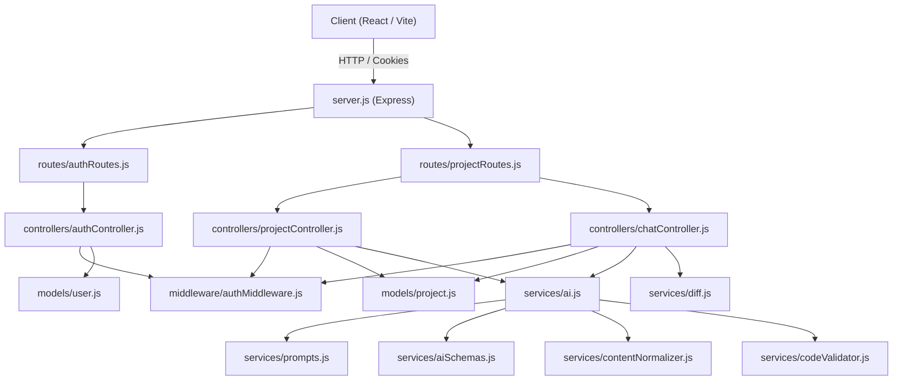

# BuilderAI Backend Server Architecture & Function Reference

This document provides a comprehensive technical breakdown of every file, model, controller, middleware, route, and service in the **BuilderAI** backend (`server/`).

---

## 1. High-Level Architecture Overview

The backend is built with **Node.js**, **Express 5**, and **MongoDB (Mongoose)**, following a modular MVC/Service pattern:
- **`config/`**: Database connections and environment initialization.
- **`models/`**: Mongoose schemas for data persistence (`User`, `Project`).
- **`middleware/`**: Request interceptors (JWT authentication and route protection).
- **`routes/`**: Express route declarations mapping HTTP methods and paths to controllers.
- **`controllers/`**: HTTP request handlers processing input, orchestrating services, and returning responses.
- **`services/`**: Core business logic, including AI model orchestration (Vercel AI SDK + OpenRouter), AST/regex code validation, diffing/patching, content normalization, and prompt engineering.



---

## 2. Server Entry Point & Configuration

### `server.js`
- **Location**: `server/server.js`
- **Purpose**: Initializes the Express application, establishes the database connection, configures global middleware (CORS, JSON body parser, Cookie parser), mounts root API routers, registers the centralized error-handling middleware, and binds the HTTP server to the designated port.
- **Key Modules / Imports**: `express`, `dotenv/config`, `cors`, `cookie-parser`, `connectToDatabase`, `authRoutes`, `projectRoutes`.
- **Global Middleware**:
  - `cors({ origin: process.env.ORIGINS.split(","), credentials: true })`: Restricts Cross-Origin requests to allowed origins while enabling credentials (cookies).
  - `cookieParser()`: Parses HTTP cookies (specifically JWT session tokens).
  - `express.json()`: Parses incoming JSON request payloads.
  - Centralized Error Handler: `app.use((err, _req, res, _next) => ...)` catches unhandled exceptions, logs them with an `[Error]` prefix, and returns `{ error: err.message }` with HTTP status 500.

### `config/db.js`
- **Location**: `server/config/db.js`
- **Purpose**: Configures and manages the Mongoose MongoDB connection.
- **Exported Functions**:
  - `connectToDatabase()`:
    - **Parameters**: None.
    - **Logic**: Attaches a one-time `'connected'` listener to `mongoose.connection` that prints `"Successfully connected to MongoDB"`, then calls `mongoose.connect(process.env.MONGODB_URI)`.
    - **Returns**: Promise resolving once the connection is established.

---

## 3. Data Models (`models/`)

### `models/user.js`
- **Location**: `server/models/user.js`
- **Purpose**: Defines the Mongoose schema for user accounts and password comparison methods.
- **Schema Fields (`UserSchema`)**:
  - `name` (String, required): User's full display name.
  - `email` (String, required, unique, lowercase, trimmed): Primary login identifier.
  - `password` (String, required): Bcrypt-hashed password. *(Note: The client pre-hashes passwords with SHA-256 before transmission; the server hashes that SHA-256 string with bcrypt).*
  - `timestamps`: Automatically adds `createdAt` and `updatedAt`.
- **Instance Methods**:
  - `comparePassword(password)`:
    - **Parameters**: `password` (String) — The incoming SHA-256 hashed password string from the client.
    - **Logic**: Executes `bcrypt.compare(password, this.password)`.
    - **Returns**: Promise resolving to a boolean (`true` if match, `false` otherwise).
- **Exports**: `User` (Mongoose Model).

### `models/project.js`
- **Location**: `server/models/project.js`
- **Purpose**: Stores the generated websites, project files, conversation message logs, generation progress state, and publication flags.
- **Embedded Schemas**:
  - `MessageSchema`:
    - `role`: Enum `["user", "assistant"]`.
    - `content`: Text of the prompt or assistant response.
    - `timestamp`: Date (default: `Date.now`).
  - `PlannedFileSchema`:
    - `path`: Virtual file path (e.g., `"/App.js"`, `"/components/Hero.js"`).
    - `description`: Single-sentence functional summary of the planned file.
- **Main Schema Fields (`ProjectSchema`)**:
  - `name`: Project title (default: `"Untitled Project"`).
  - `description`: User prompt / project overview.
  - `files`: `Schema.Types.Mixed` object mapping virtual file paths to `{ content: string, hash: string }`.
  - `messages`: Array of `MessageSchema`.
  - `version`: Integer tracking the revision number (starts at 0, incremented on each revision).
  - `owner`: ObjectId referencing `User` (required).
  - `published`: Boolean flag indicating if the site is publicly visible without login.
  - `status`: Enum `["pending", "generating", "revising", "completed", "failed"]`.
  - `filesPlanned`: Array of `PlannedFileSchema` created by the AI planning phase.
  - `filesGenerated`: Array of completed file paths.
  - `currentFile`: String path of the file currently being written by the AI (or `null`).
  - `error`: Error string if generation or revision failed.
  - `timestamps`: `createdAt` and `updatedAt`.
- **Exports**: `Project` (Mongoose Model).

---

## 4. Middleware (`middleware/`)

### `middleware/authMiddleware.js`
- **Location**: `server/middleware/authMiddleware.js`
- **Purpose**: Protects private API routes by verifying the JSON Web Token (JWT) stored in HTTP cookies.
- **Exported Functions**:
  - `authMiddleware(req, res, next)`:
    - **Parameters**: `req` (Request), `res` (Response), `next` (NextFunction).
    - **Logic**:
      1. Inspects `req.cookies?.token`. If missing, aborts with HTTP 401: `"Access Denied. No session token provided"`.
      2. Verifies the token using `jwt.verify(token, process.env.JWT_SECRET || 'fallback_secret')`.
      3. Assigns the decoded payload `{ userId, email }` to `req.user`.
      4. Calls `next()` on success.
      5. If verification throws an error, returns HTTP 403: `"Invalid Session Token or Expired"`.
    - **Returns**: None (passes control or terminates request).

---

## 5. Routes (`routes/`)

### `routes/authRoutes.js`
- **Location**: `server/routes/authRoutes.js`
- **Purpose**: Defines HTTP endpoints for authentication.
- **Routes**:
  - `POST /register` &rarr; `authController.register`
  - `POST /login` &rarr; `authController.login`
  - `POST /logout` &rarr; `authController.logout`
  - `GET /me` &rarr; `authMiddleware` &rarr; `authController.me`

### `routes/projectRoutes.js`
- **Location**: `server/routes/projectRoutes.js`
- **Purpose**: Defines HTTP endpoints for project creation, retrieval, updates, deletion, publishing, and chat-based revisions.
- **Routes**:
  - `GET /public/:id` &rarr; `projectController.getPublicProject` (Public route, unauthenticated).
  - *(All subsequent routes are guarded by `authMiddleware`)*:
  - `POST /` &rarr; `projectController.createProject`
  - `GET /` &rarr; `projectController.listProjects`
  - `GET /:id` &rarr; `projectController.getProject`
  - `DELETE /:id` &rarr; `projectController.deleteProject`
  - `PUT /:id` & `PUT /:id/files` &rarr; `projectController.updateProjectFiles`
  - `POST /:id/publish` &rarr; `projectController.publishProject`
  - `POST /:id/chat` &rarr; `chatController.chat`

---

## 6. Controllers (`controllers/`)

### `controllers/authController.js`
- **Location**: `server/controllers/authController.js`
- **Purpose**: Handles user registration, credentials authentication, session cookie issuance, and session checks.
- **Internal Helper**:
  - `setSessionCookie(res, payload)`:
    - **Parameters**: `res` (Express Response), `payload` (Object with `userId` and `email`).
    - **Logic**: Signs a JWT with 30-day expiration (`jwt.sign(payload, JWT_SECRET, { expiresIn: '30d' })`) and sets an `httpOnly`, `sameSite: "lax"`, 30-day cookie named `token`. In production, sets `secure: true`.
- **Exported Functions**:
  - `register(req, res)`:
    - **Input**: `req.body` containing `{ name, email, password }` (where `password` is client SHA-256).
    - **Logic**: Validates inputs; checks if the email already exists (returns 400 if duplicate); hashes the incoming password using `bcrypt.genSalt(10)` and `bcrypt.hash`; creates a new `User` document; calls `setSessionCookie`; returns HTTP 201 with sanitized user info `{ _id, name, email }`.
  - `login(req, res)`:
    - **Input**: `req.body` containing `{ email, password }`.
    - **Logic**: Validates inputs; queries user by lowercase trimmed email (returns 404 if not found); verifies password via `user.comparePassword(password)` (returns 401 if invalid); calls `setSessionCookie`; returns HTTP 201 with user info `{ _id, name, email }`.
  - `logout(_req, res)`:
    - **Logic**: Clears the `token` cookie by setting `maxAge: 0` and value `""`. Returns `{ success: true }`.
  - `me(req, res)`:
    - **Logic**: Checks `req.user.userId`. Queries `User.findById(req.user.userId).select("-password")`. If user exists, responds with `{ user }`; otherwise returns 404 or 401.

### `controllers/projectController.js`
- **Location**: `server/controllers/projectController.js`
- **Purpose**: Manages lifecycle, CRUD, publishing, and asynchronous background generation for projects.
- **Internal Helpers**:
  - `hashContent(content)`:
    - **Parameters**: `content` (String).
    - **Logic**: Generates an MD5 digest of the string and slices the first 12 characters (`crypto.createHash('md5').update(content).digest('hex').slice(0, 12)`).
    - **Returns**: 12-character hexadecimal hash string.
  - `runBackgroundGeneration(projectId, prompt)`:
    - **Parameters**: `projectId` (String), `prompt` (String).
    - **Logic**:
      1. Calls `generateProject(prompt, { onPlan, onFileStart, onFileComplete })`.
      2. `onPlan(plan)`: Updates project name, sets `status: "generating"`, saves `filesPlanned`, and appends an assistant message listing all planned files.
      3. `onFileStart(path)`: Sets `project.currentFile = path`.
      4. `onFileComplete(path, code)`: Inserts file into `project.files[path] = { content: code, hash }`, appends path to `filesGenerated`, logs assistant message, clears `currentFile`, and saves.
      5. On successful completion: Marks `status: "completed"`, sets `version = 1`, updates `name` if description exists, and adds completion message.
      6. On error: Catches failure, sets `status: "failed"`, logs `error: err.message`, and pushes failure message to chat log.
- **Exported Functions**:
  - `createProject(req, res)`:
    - **Input**: `req.body.prompt`.
    - **Logic**: Validates prompt and user authentication; creates initial `Project` record with `status: "pending"`; launches `runBackgroundGeneration` asynchronously in the background without blocking the HTTP response; immediately responds with HTTP 201 containing project metadata and initial status.
  - `listProjects(req, res)`:
    - **Logic**: Queries `Project.find({ owner: req.user.userId })` selecting fields `{ name, description, status, createdAt, updatedAt }`, sorted newest first (`sort({ updatedAt: -1 })`), and responds with the array.
  - `getProject(req, res)`:
    - **Input**: `req.params.id`.
    - **Logic**: Finds project by ID and owner; unwraps `files` from `{ content, hash }` to a clean `{ [path]: content }` map for frontend consumption; returns project details with unwrapped files.
  - `deleteProject(req, res)`:
    - **Input**: `req.params.id`.
    - **Logic**: Executes `Project.findOneAndDelete({ _id: req.params.id, owner: req.user.userId })`. Returns `{ success: true }` or 404.
  - `updateProjectFiles(req, res)`:
    - **Input**: `req.params.id`, `req.body.files` (dictionary of file paths to code strings).
    - **Logic**: Validates files object; loads user project; transforms strings into `{ content, hash: hashContent(content) }`; saves updated files to DB; returns updated project object.
  - `publishProject(req, res)`:
    - **Input**: `req.params.id`.
    - **Logic**: Updates project with `{ published: true }`. Returns `{ success: true, project: true }`.
  - `getPublicProject(req, res)`:
    - **Input**: `req.params.id`.
    - **Logic**: Finds project by ID. If not found, returns 404. If `project.published` is false, returns HTTP 403 (`"Project is not published"`). Otherwise, unwraps file contents and returns `{ _id, name, description, files, version }`.

### `controllers/chatController.js`
- **Location**: `server/controllers/chatController.js`
- **Purpose**: Handles AI chat prompts to iteratively edit and revise an existing project.
- **Exported Functions & Helpers**:
  - `buildManifest(files)`:
    - **Parameters**: `files` (Object: file path &rarr; `{ content, hash }`).
    - **Logic**: Iterates over files and constructs a compact array of `{ path, hash, size }`.
    - **Returns**: Array of file metadata objects used to give the AI context without sending whole codebases if not needed.
  - `chat(req, res)`:
    - **Input**: `req.params.id`, `req.body.prompt`.
    - **Logic**:
      1. Validates prompt and verifies user owns the project.
      2. Sets `project.status = "revising"`, appends user message to `project.messages`, and saves.
      3. Builds manifest with `buildManifest()`.
      4. Extracts relevant file contents and extracts the last 4 messages for conversational context.
      5. Calls `reviseProject(prompt, manifest, relevantFiles, recentMessages)`.
      6. Receives atomic operations (`create`, `update`, `delete`).
      7. Applies operations using `applyOperations(project.files, result.operations)` from `services/diff.js`.
      8. Increments `project.version += 1`, sets `status = "completed"`, pushes assistant response summary to messages, and saves to MongoDB.
      9. Responds with the updated project, files, applied operations, and any errors.

---

## 7. AI & Code Services (`services/`)

### `services/ai.js`
- **Location**: `server/services/ai.js`
- **Purpose**: Core AI orchestration layer interfacing with OpenRouter and Vercel AI SDK (`@ai-sdk/openai`). Handles structured JSON output generation, concurrency limiting, and retry handling.
- **Configuration**:
  - `openrouter`: Created via `createOpenAI({ baseURL: 'https://openrouter.ai/api/v1', apiKey })`.
  - `model`: Configured via `process.env.OPENROUTER_MODEL` (defaulting to `"openrouter/free"`).
  - `MAX_CONCURRENCY`: Concurrency limit for parallel file generation (default: 6).
- **Internal Helper**:
  - `generateSingleFile(file, allFiles, prompt, alreadyGeneratedFiles)`:
    - **Parameters**: `file` (Planned file object), `allFiles` (Array of planned files), `prompt` (User prompt), `alreadyGeneratedFiles` (Map of already generated files).
    - **Logic**:
      1. Constructs tailored system prompt via `buildFileCodeSystem(allFiles, alreadyGeneratedFiles)`.
      2. Invokes `generateObject()` with `schema: FileCodeSchema` and `maxRetries: 2`.
      3. Cleans returned string using `normalizeContent(object.code)`.
      4. Validates and auto-fixes syntax/imports using `validateAndFixCode(code, file.path, { allPlannedFiles: allFiles })`.
      5. Logs warnings if adjustments were made.
    - **Returns**: Promise resolving to `{ path: file.path, code }`.
- **Exported Functions**:
  - `generateProject(prompt, callbacks)`:
    - **Parameters**: `prompt` (String), `callbacks` (Object: `{ onPlan, onFileStart, onFileComplete }`).
    - **Logic**:
      - **Phase 1: Architecture Planning**: Invokes `generateObject()` with `schema: FilePlanSchema` and `system: FILE_PLAN_SYSTEM`. Guarantees `/App.js` and `/styles.css` exist in the plan. Triggers `callbacks.onPlan(plan)`.
      - **Phase 2: Parallel Code Generation**: Uses `pMap` with `concurrency: MAX_CONCURRENCY` to generate all files concurrently.
      - **Retry Mechanism**: Implements up to 2 retry rounds for any files that fail in the first attempt.
      - **Fallback Placeholder**: If non-critical files fail after retries, inserts a clean fallback placeholder component so the project builds without crashing.
      - Verifies `/App.js` was created.
    - **Returns**: Promise resolving to `{ files: { [path]: code }, description }`.
  - `reviseProject(prompt, manifest, relevantFiles, recentMessages)`:
    - **Parameters**: `prompt` (String), `manifest` (Array), `relevantFiles` (Object), `recentMessages` (Array).
    - **Logic**:
      1. Assembles prompt context containing file manifest, reference file contents, recent chat history, and revision request.
      2. Calls `generateObject()` using `schema: RevisionResultSchema` and `system: REVISE_SYSTEM`.
      3. Normalizes operation names (`add`/`new` &rarr; `create`, `edit`/`patch` &rarr; `update`, `rm`/`del` &rarr; `delete`).
      4. Ensures leading slash on all paths.
      5. Normalizes content (`normalizeContent`) and runs validation (`validateRevisionContent`).
    - **Returns**: Promise resolving to raw parsed revision object with validated operations and description.

### `services/aiSchemas.js`
- **Location**: `server/services/aiSchemas.js`
- **Purpose**: Defines Zod validation schemas enforcing strict JSON structure from LLM completions.
- **Exported Schemas**:
  - `GenerationResultSchema`: Validates `{ files: Record<string, string>, description: string }`.
  - `FileOpSchema`: Validates atomic operations:
    - `op`: Enum `["create", "update", "delete"]`.
    - `path`: String.
    - `content`: String (optional/nullable).
    - `search`: String (optional/nullable).
    - `replace`: String (optional/nullable).
  - `RevisionResultSchema`: Validates `{ operations: FileOpSchema[], description: string }`.
  - `FilePlanSchema`: Validates architecture plans:
    - `files`: Array of `{ path, description, exports, imports }`.
    - `projectName`: String.
    - `projectDescription`: String.
  - `FileCodeSchema`: Validates single file generation `{ code: string }`.

### `services/prompts.js`
- **Location**: `server/services/prompts.js`
- **Purpose**: Central prompt engineering repository containing detailed rules on UI/UX standards, typography, color themes, responsive layouts, Tailwind classes, and code syntax.
- **Exported Prompts & Functions**:
  - `BASE_SYSTEM`: Comprehensive system prompt instructing the AI on design standards:
    - Intent recognition: Interactive Games/Apps (single-file `/App.js` rule) vs SaaS landing pages (modular sections).
    - Typography rules: Google font imports (`Inter`, `Plus Jakarta Sans`), strict H1-H3 scale, tracking.
    - Color palette: Default light mode mandate (`#ffffff`, `#fafafa`), zinc scales, single accent colors.
    - Layout: Responsive container widths (`max-w-7xl mx-auto px-6 md:px-12`), section padding (`py-20 md:py-32`), gap rules.
    - Breakpoint rules: Mobile-first responsive classes (`sm:`, `md:`, `lg:`).
    - Icons: Font Awesome 6 Free icon classes.
    - Images: Verified Unsplash photo IDs.
  - `REVISE_SYSTEM`: System prompt guiding the AI to return search-and-replace or atomic file operations for revisions.
  - `FILE_PLAN_SYSTEM`: Prompt directing the AI to produce a JSON project plan specifying files, component roles, imports, and exports.
  - `buildFileCodeSystem(allFiles, alreadyGeneratedFiles)`:
    - **Parameters**: `allFiles` (Array of planned files), `alreadyGeneratedFiles` (Object of code generated so far).
    - **Logic**: Formats the planned file list and appends the source code of already generated files into a system prompt so the LLM has exact context for cross-file imports and props contracts.
    - **Returns**: Formatted system prompt string.

### `services/codeValidator.js`
- **Location**: `server/services/codeValidator.js`
- **Purpose**: Post-processing AST/regex validation engine that automatically inspects and repairs syntax errors in AI-generated React/JSX code before writing to the database.
- **Exported Functions**:
  - `validateAndFixCode(code, filePath, context)`:
    - **Parameters**: `code` (String), `filePath` (String), `context` (Object with `allPlannedFiles`).
    - **Repairs Applied**:
      1. Strips accidental markdown code fences (```jsx ... ```).
      2. Replaces JSX `class=` with `className=`.
      3. Replaces `<label for=` with `<label htmlFor=`.
      4. Auto-closes void HTML tags (e.g., ``, `<input ...>`, `<hr>`, `<br>`).
      5. Ensures at least one `export default` statement exists.
      6. Removes illegal HTML comments (`<!-- ... -->`) from JSX.
      7. Strips accidental TypeScript type annotations (`: React.FC`, `: string`, etc.).
      8. Injects `import React from 'react';` if JSX tags are detected and import is missing.
      9. Sanitizes unclosed curly brace strings (`{'`).
      10. Calls `fixImportPaths()` to rewrite wrong relative paths to match planned paths.
    - **Returns**: `{ code, warnings }`.
  - `validateRevisionContent(content, filePath, op)`:
    - **Parameters**: `content` (String), `filePath` (String), `op` (String: `"create"` | `"update"` | `"delete"`).
    - **Logic**: If `op === "create"`, runs `validateAndFixCode`. If `op === "update"`, applies non-destructive JSX repairs (`className`, `htmlFor`, void tags) on replacement snippets.
    - **Returns**: `{ content, warnings }`.
- **Internal Path Resolution Helpers**:
  - `getDir(p)`: Extracts directory portion of a path.
  - `resolvePath(baseDir, relativePath)`: Resolves `.` and `..` relative path segments to an absolute virtual path.
  - `getRelativePath(fromDir, toPath)`: Computes the relative path between two directories.
  - `cleanExtension(p)`: Removes `.js`, `.jsx`, `.css`, `.ts`, `.tsx` extensions.
  - `fixImportPaths(code, filePath, allPlannedFiles)`: Scans import statements via regex; detects broken relative paths; matches the imported filename against planned file paths; rewrites the import path to the correct relative target.

### `services/contentNormalizer.js`
- **Location**: `server/services/contentNormalizer.js`
- **Purpose**: Cleans up formatting artifacts and escape sequence bugs resulting from LLM JSON string encoding.
- **Exported Functions**:
  - `normalizeContent(content)`:
    - **Parameters**: `content` (String).
    - **Logic**:
      1. Strips UTF-8 Byte Order Mark (BOM: `\ufeff`).
      2. Normalizes Windows CRLF (`\r\n`) to standard LF (`\n`).
      3. Resolves double-escaped newlines (`\\n` &rarr; `\n`) while preserving intentionally escaped characters.
      4. Cleans up backslash-escaped quotes in JSX attributes (`className=\"...\"` &rarr; `className="..."`).
    - **Returns**: Cleaned normalized string.

### `services/diff.js`
- **Location**: `server/services/diff.js`
- **Purpose**: Implements diffing, hashing, and patch application for AI revisions.
- **Exported Functions**:
  - `hashContent(content)`: Generates 12-char MD5 hash of string content.
  - `applyOperations(currentFiles, operations)`:
    - **Parameters**: `currentFiles` (Object: file path &rarr; `{ content, hash }`), `operations` (Array of operations).
    - **Logic**:
      - Iterates through `operations`:
        - `"create"`: Creates/overwrites `files[op.path]` with `{ content, hash }`.
        - `"update"`: Locates `files[op.path]`, performs `searchReplace()`, and updates content and hash.
        - `"delete"`: Deletes key from `files` dictionary.
      - Collects `applied` logs and `errors` logs without halting on partial failures.
    - **Returns**: `{ files, applied, errors }`.
- **Internal Helper**:
  - `searchReplace(content, search, replace)`:
    - **Parameters**: `content` (String), `search` (String), `replace` (String).
    - **Logic**:
      1. **Exact match**: Checks `content.includes(search)`. If found, performs standard string replacement.
      2. **Whitespace-tolerant match fallback**: If exact match fails, collapses consecutive whitespace and trims each line (`normalizeWs`). Searches for the normalized block in the normalized content and slices the line array to perform the replacement while preserving original indentation surrounding it.
    - **Returns**: New modified string or `null` if search target was not found.
